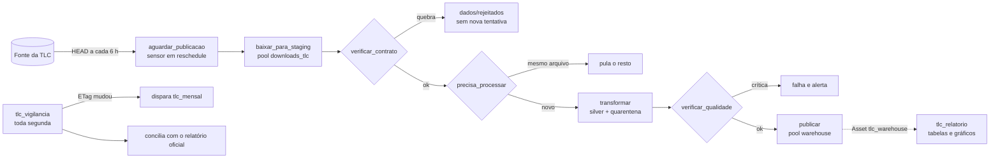
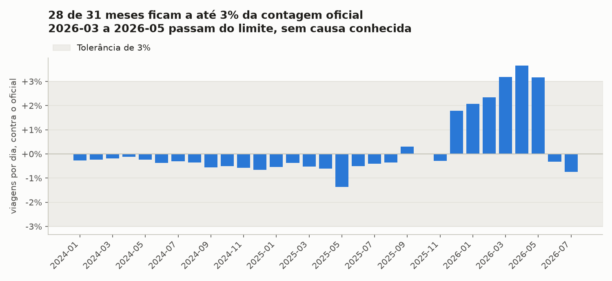
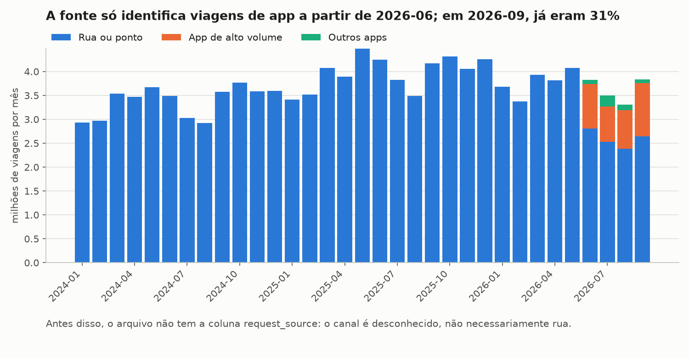
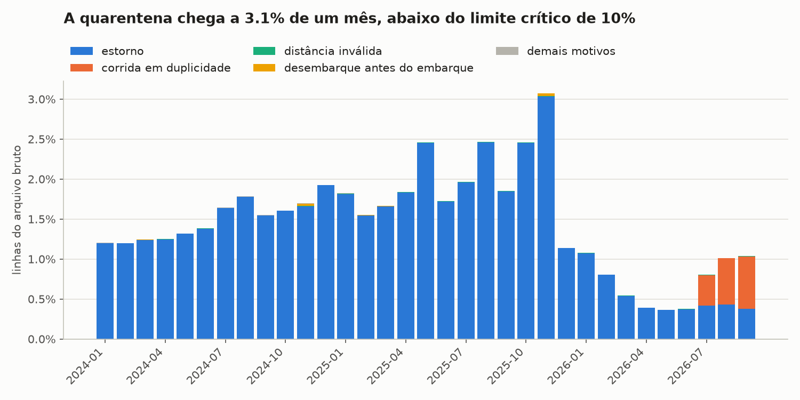
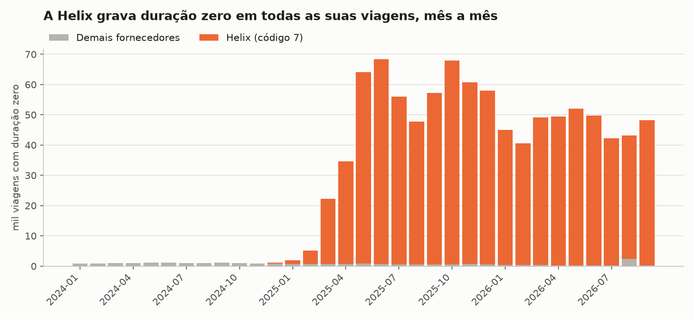

# Orquestração com Airflow: táxis de Nova York

Pipeline mensal orquestrado com **Apache Airflow 3.4** sobre **dados reais** das viagens de táxi
amarelo de Nova York, publicados pela Taxi and Limousine Commission (TLC). São 33 meses, de janeiro
de 2024 a setembro de 2026: 123,5 milhões de linhas brutas e 2,1 GB em Parquet.

O foco é a orquestração: esperar um arquivo que não tem data para sair, repetir só o que vale a
pena repetir, reprocessar o passado sem duplicar nada, avisar quando algo dá errado e provar que
o resultado bate com uma fonte independente. Ao final há uma versão curta do mesmo fluxo em
**Prefect**, para comparar.

## O problema

A TLC publica um arquivo Parquet por mês, com cerca de dois meses de atraso e sem data fixa.
Rodar o pipeline à mão, como nos projetos anteriores, deixa várias perguntas sem resposta:

- Quem percebe que o arquivo de outubro saiu, e quando?
- O que acontece se o download cair no meio, ou se a fonte mudar o formato?
- Como carregar dois anos e meio de histórico sem rodar 33 vezes à mão?
- Se a TLC republicar um mês antigo, quem refaz esse mês?
- Como saber se os números estão certos, se dados reais não vêm com gabarito?

## Origem dos dados

| Fonte | Uso |
|---|---|
| [Trip Record Data](https://www.nyc.gov/site/tlc/about/tlc-trip-record-data.page): `yellow_tripdata_AAAA-MM.parquet` | Viagens, um arquivo por mês |
| [Dicionário de dados](https://www.nyc.gov/assets/tlc/downloads/pdf/data_dictionary_trip_records_yellow.pdf) (março de 2025) | Códigos de fornecedor, pagamento e tarifa |
| `taxi_zone_lookup.csv` | As 265 zonas de embarque e desembarque |
| [`data_reports_monthly.csv`](https://www.nyc.gov/assets/tlc/downloads/csv/data_reports_monthly.csv) | Viagens por dia que a TLC divulga; serve de gabarito |

Os dados são baixados na execução e **não ficam no repositório**: a página da TLC diz que os
registros vêm dos fornecedores de tecnologia e que a TLC não garante sua exatidão, e os termos de
uso do NYC.gov reservam os direitos do conteúdo. O repositório guarda só código e agregados. Os
testes usam linhas escritas à mão, sem nenhum registro real.

## O que os dados reais trouxeram

Nada disso foi planejado: apareceu na exploração e mudou as regras do pipeline.

| Achado | Tamanho | Tratamento |
|---|---|---|
| Linhas de **estorno**, com total negativo, quase sempre ao lado da viagem original de mesmo horário e valor | 1,76 milhão (1,4% do bruto) | Quarentena: somar contaria a corrida e o estorno |
| O fornecedor 1 manda parte das corridas **duas vezes** desde julho de 2026: um registro como app e outro como taxímetro, com o mesmo horário, trajeto e valores | 58.137 | Quarentena; fica o registro de app, o único que informa o canal |
| O fornecedor 7 (Helix) grava **embarque e desembarque no mesmo segundo** em todas as suas viagens | 975.642 viagens com duração zero | Ficam na silver, marcadas com `duracao_valida` falso, e saem só das médias de duração |
| Viagens com embarque em **2002 ou 2009** dentro do arquivo de 2026, e de outubro no arquivo de setembro | 802 | Quarentena: fora do mês |
| Distância de **232.644 milhas** e totais acima de US$ 10 mil | 4.200 | Quarentena acima de 200 milhas ou US$ 1.000 |
| **Duas colunas novas** em 2025 e 2026 (`cbd_congestion_fee`, `request_source`) e `Airport_fee` que vira `airport_fee` | Esquema muda entre meses | O contrato compara nomes sem diferenciar caixa e preenche com nulo o que o mês ainda não tinha |
| Um mês ainda não publicado responde **403**, e não 404 | Todo mês futuro | O sensor trata 403 e 404 como "ainda não saiu" |
| O total cobrado **não fecha** com a soma das parcelas | 33,9% das viagens | Só alerta: não investiguei a causa |

No total foram 121.644.404 viagens na silver e 1.827.317 linhas em quarentena, ou 1,48% do bruto.
Todas as linhas estão contadas: em cada mês, bruto = silver + quarentena.

## Arquitetura



| DAG | Agenda | Função |
|---|---|---|
| `tlc_mensal` | Dia 1º, 6h UTC, cuidando do mês anterior | Espera, baixa, valida, transforma e publica um mês |
| `tlc_vigilancia` | Segunda, 7h UTC | Detecta meses republicados pelo ETag e concilia com o relatório oficial |
| `tlc_relatorio` | Quando o Asset `tlc_warehouse` muda | Refaz tabelas e gráficos; agenda por dado, não por hora |

**Camadas**

- **staging:** download com nome único por execução. Só sai daqui o que cumpre o contrato.
- **raw:** o arquivo aprovado, com SHA-256, ETag e data de publicação em `dados/controle`.
- **silver:** Parquet por mês, com colunas padronizadas, canal (`Rua ou ponto`, `App de alto
  volume`, `Outros apps`) e marcas de qualidade.
- **quarentena:** as linhas recusadas, com `motivo_rejeicao`.
- **warehouse:** DuckDB com agregados por dia, fornecedor e zona.

## Decisões de orquestração

| Situação | Decisão | Por quê |
|---|---|---|
| O arquivo sai com atraso e sem data | Sensor com `mode="reschedule"`, consulta a cada 6 h e desiste em 75 dias | Em reschedule, o sensor libera a vaga entre as consultas. Esperar dois meses em modo `poke` ocuparia uma vaga o tempo todo |
| Qual mês uma execução processa | `CronDataIntervalTimetable`: a execução de 1º de novembro cuida de outubro | No Airflow 3, um cron simples não tem intervalo de dados. Minha primeira versão usava um cron e mandava a execução de novembro procurar o arquivo de novembro |
| Falhas de rede | 3 novas tentativas com espera exponencial, de 30 s até 10 min | Quedas de rede passam sozinhas |
| Quebra de contrato ou de qualidade | `AirflowFailException`: falha sem nova tentativa | Repetir não conserta um arquivo sem coluna |
| Mesmo arquivo de novo | Download pulado pelo ETag e `short_circuit` pelo SHA-256 | Reprocessar não deve baixar nem publicar nada repetido |
| Escrita no DuckDB | Pool `warehouse` com 1 vaga; troca do mês inteiro em uma transação | DuckDB aceita um único processo escritor |
| Respeito à fonte | Pool `downloads_tlc` com 2 vagas | Um backfill não deve disparar 33 downloads ao mesmo tempo |
| Estado de cada mês | Um JSON por mês, gravado de forma atômica | Tarefas paralelas consultam o estado sem disputar a trava do DuckDB |
| Alertas | `on_failure_callback` e `on_retry_callback` gravam em `dados/alertas.jsonl` e, se `ALERTA_WEBHOOK_URL` existir, enviam ao webhook | O webhook é opcional e nunca foi testado com um serviço real |

## Verificações de qualidade

| Verificação | Nível | Regra |
|---|---|---|
| Conservação de linhas | crítica | bruto = silver + quarentena |
| Silver não vazia | crítica | ao menos uma viagem |
| Silver dentro do mês | crítica | nenhum embarque fora do mês |
| Taxa de quarentena | crítica | até 10% do bruto |
| Fornecedor no dicionário | alerta | código 1, 2, 6 ou 7 |
| Colunas novas na fonte | alerta | lista vazia |
| Volume contra o histórico | alerta | até ±40% da mediana dos 12 meses anteriores |
| Conciliação com o oficial | alerta, na vigilância | até ±3% das viagens por dia publicadas pela TLC |

## Resultados

### Conciliação com o relatório oficial



Dos 33 meses, 31 já constam no relatório oficial, e 28 deles ficam a até 3% da contagem da TLC,
com diferença mediana de 0,5%. Sem o tratamento, a diferença mediana seria de 1,25%, sempre para
mais: os estornos e as corridas em duplicidade explicam a maior parte da sobra.

**De março a maio de 2026, o pipeline fica 3,2% a 3,7% acima do oficial, e não sei explicar.** Não
há duplicidades pela regra atual nesses meses, e a coluna `request_source` só aparece em junho de
2026. A vigilância gerou o alerta, que fica em aberto. Agosto e setembro de 2026 aguardam o
relatório oficial.

### Canal das viagens



Desde junho de 2026, o arquivo informa o canal de cada viagem, e em setembro 31% delas vieram de
apps, quase todas pelas licenças `HV0003` e `HV0005`, de alto volume. **Antes de junho de 2026 o
canal é desconhecido**, não necessariamente rua: o gráfico não mostra o crescimento dos apps, só o
momento em que a fonte passou a registrá-lo.

### Quarentena



### Duração zero



### O que a execução real mostrou

As tarefas, tentativas e durações estão em
[`output/evidencias/tarefas.csv`](output/evidencias/tarefas.csv), exportadas do banco de metadados
do Airflow.

| Evento | O que aconteceu |
|---|---|
| Backfill de 33 meses | `airflow backfill create --from-date 2024-01-01 --to-date 2026-09-30 --max-active-runs 4`. Download médio de 53 s e transformação média de 8 s por mês |
| Quedas de rede reais | Erros de DNS e tempo esgotado. A maioria passou com as novas tentativas; os meses que esgotaram as tentativas foram refeitos com um novo backfill, que só baixou os arquivos que faltavam |
| O Mac dormiu durante o backfill | Ao acordar, as tarefas falharam com `Invalid auth token`, porque o token tinha expirado. A verificação de qualidade não tinha novas tentativas e falhou de vez. Agora ela tem: reprovação de qualidade continua sem repetir, mas falha de infraestrutura repete |
| Regra com defeito em produção | Uma regra de duplicidade quebrada mandou quase 100% de dois meses para a quarentena. A verificação crítica barrou os dois e nada chegou ao warehouse |
| Reprocessamento do histórico | 33 meses refeitos com `forcar`, sem baixar de novo: o ETag não tinha mudado |
| Execução agendada real | A execução de outubro de 2026 está no sensor, esperando o arquivo, que ainda responde 403 |
| Relatório por Asset | `tlc_relatorio` rodou 61 vezes, uma para cada publicação |

O tempo total do backfill não é uma boa medida: inclui as horas em que o Mac dormiu.

### Falhas simuladas

O serviço `fonte-instavel`, ativado com `--profile falhas`, imita a fonte com defeito. As três
execuções rodaram ao mesmo tempo, para o mesmo mês:

| Cenário | Resultado |
|---|---|
| Fonte responde 503 duas vezes | Sucesso na 3ª tentativa, reprocessamento e o mesmo total de 3.835.902 viagens |
| Download cortado na metade | 4 tentativas e falha com alerta; o arquivo anterior continua intacto |
| Arquivo sem `total_amount` | Falha no contrato sem nova tentativa; o arquivo vai para `dados/rejeitados` |

O SHA-256 de `raw/yellow_tripdata_2026-09.parquet` ficou igual antes e depois dos três cenários.

Na primeira rodada, a execução da fonte instável falhou por um defeito meu: as três execuções
usavam o mesmo arquivo temporário, e o download de uma apagava o da outra. Agora cada execução
grava um arquivo com nome próprio.

## Airflow contra Prefect

[`comparacao_prefect/fluxo.py`](comparacao_prefect/fluxo.py) faz o mesmo fluxo em Prefect 3.9,
reaproveitando `src/`. Rodei um mês, setembro de 2026, de ponta a ponta.

| Aspecto | Airflow | Prefect |
|---|---|---|
| Para rodar um mês | Docker Compose com 4 serviços e PostgreSQL | `python fluxo.py 2026-09`, com servidor temporário |
| Tamanho | DAG com cerca de 200 linhas | Fluxo com 70 linhas |
| Esperar um arquivo | Sensor em reschedule, que libera a vaga | Não usei sensor: "ainda não publicado" virou falha com novas tentativas |
| Backfill | `airflow backfill create`, com controle de concorrência | Não há comando equivalente; seria um laço de execuções com parâmetros. Não testei |
| Agendamento por dado | `Asset` dispara `tlc_relatorio` | Não testei |
| Pools e limites | Pools nativos para downloads e warehouse | Não testei |

Os dois chegaram às mesmas 3.835.902 viagens. A comparação também revelou um defeito meu: na
primeira versão, 198 linhas mudavam entre as execuções do Airflow e do Prefect, porque a escolha
da linha mantida em uma duplicidade era arbitrária. Agora o desempate é fixo, e o teste
`test_mesmo_arquivo_gera_o_mesmo_resultado` garante isso.

A comparação é curta e limitada a um mês: o Prefect tem agendamento, deployments e limites de
concorrência, que eu não exercitei aqui.

## Estrutura

```
10-airflow-orchestration/
├── dags/
│   ├── tlc_mensal.py          # ingestão de um mês
│   ├── tlc_vigilancia.py      # republicações e conciliação
│   └── tlc_relatorio.py       # disparada pelo Asset do warehouse
├── src/                       # lógica sem Airflow, testável e reaproveitada pelo Prefect
│   ├── config.py  fonte.py  contrato.py  silver.py  qualidade.py
│   ├── warehouse.py  reconciliacao.py  alertas.py  controle.py
│   └── relatorio.py  visualize.py
├── comparacao_prefect/        # o mesmo fluxo em Prefect
├── scripts/
│   ├── fonte_instavel.py      # fonte com defeito, para testes de falha
│   └── coletar_evidencias.sh  # exporta o histórico de execuções
├── tests/                     # 48 testes
├── output/                    # tabelas, gráficos e evidências
├── docker-compose.yml  Dockerfile  .env.example
└── dados/                     # fora do Git: raw, silver, quarentena, warehouse
```

## Tecnologias

Apache Airflow 3.4 com LocalExecutor, PostgreSQL 16 para os metadados, Docker Compose, DuckDB 2.0,
Parquet, Python 3.14, pandas e matplotlib, pytest e Prefect 3.9 na comparação.

## Como rodar

Requer Docker com ao menos 4 GB de memória. O primeiro build baixa a imagem do Airflow, com cerca
de 3 GB.

```bash
cp .env.example .env
docker compose up -d --build
```

A interface fica em http://localhost:8085, com usuário e senha `airflow`, apenas para uso local.

```bash
# um mês
docker compose exec airflow-scheduler airflow dags unpause tlc_mensal
docker compose exec airflow-scheduler airflow dags trigger tlc_mensal --conf '{"mes": "2026-09"}'

# histórico: cada mês baixa cerca de 60 MB
docker compose exec airflow-scheduler airflow backfill create --dag-id tlc_mensal \
  --from-date 2024-01-01 --to-date 2026-09-30 --max-active-runs 4

# reprocessar sem baixar de novo
docker compose exec airflow-scheduler airflow backfill create --dag-id tlc_mensal \
  --from-date 2024-01-01 --to-date 2026-09-30 --reprocess-behavior completed \
  --dag-run-conf '{"forcar": true}'
```

Falhas simuladas:

```bash
docker compose --profile falhas up -d fonte-instavel
docker compose exec airflow-scheduler airflow dags trigger tlc_mensal \
  --conf '{"mes": "2026-09", "base_url": "http://fonte-instavel:8000/instavel", "rebaixar": true, "forcar": true}'
```

Testes:

```bash
python3 -m pytest -q                                          # fora do contêiner; os testes de DAG são pulados
docker compose exec airflow-scheduler python -m pytest -q tests   # todos, inclusive os de DAG
```

Comparação com Prefect:

```bash
python3 -m venv .venv-prefect
.venv-prefect/bin/pip install -r comparacao_prefect/requirements.txt
.venv-prefect/bin/python comparacao_prefect/fluxo.py 2026-09
```

## Limitações

- **Divergência em aberto:** de março a maio de 2026, a contagem fica 3,2% a 3,7% acima do oficial,
  sem explicação.
- **Soma não investigada:** em 33,9% das viagens, o total não fecha com a soma das parcelas, e não
  investiguei por quê.
- **Canal incompleto:** o canal só existe a partir de junho de 2026.
- **Ambiente local:** é um Airflow de uma máquina, com LocalExecutor e senhas de desenvolvimento.
  Em produção, os segredos iriam para um gerenciador e os dados para um storage de objetos.
- **Alertas:** os alertas ficam em arquivo; o envio para webhook foi escrito, mas nunca testado com
  um serviço real.
